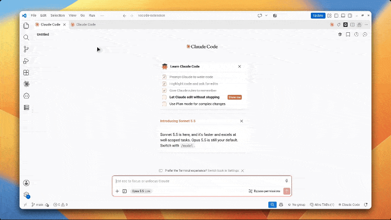

# Tabs Emoji

Put an emoji on any editor tab so you can spot it at a glance. Works on normal files and on webview tabs such as Claude Code chats, where VS Code offers no tab colors or groups.

## Usage

1. Right-click a tab (or a file in the Explorer) → **Tabs Emoji: Set Emoji...**
2. Click an emoji in the grid. It appears on the tab and in the Explorer.
3. To clear it, open the picker again and click **Remove emoji**.

Emojis are remembered across reloads.

## Limits

- VS Code tab badges fit at most 2 characters, so some emojis (like keycap numbers 1️⃣) aren't offered.
- Claude Code / webview tabs get a new internal id on every reload. Tabs Emoji re-attaches the emoji by the tab's title and position. If a chat's title changes after you mark it and several chats are open, the emoji may be lost and need setting again.
